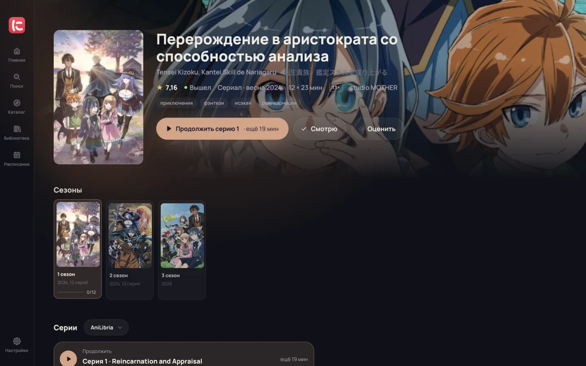

<div align="center">


# ninari

**Anime from every dub in one window**

The Shikimori catalogue, episodes from many sources with each dub's best quality,
an mpv player with Anime4K and ArtCNN upscaling, and progress that never gets lost.

[](https://github.com/onokashino/ninari/releases/latest)
[](LICENSE)
[](https://onokashino.github.io/ninari/en/)

[Site](https://onokashino.github.io/ninari/en/) ·
[Download](https://onokashino.github.io/ninari/en/download/) ·
[Docs](https://onokashino.github.io/ninari/en/docs/) ·
[Plugins](https://onokashino.github.io/ninari/en/plugins/) ·
[Русский](README.md)



</div>

> The app speaks Russian for now; an English interface comes later.

## Features

- **Every dub at once.** The app asks each source you've added and merges one dub team from different sites into one line with its best quality.
- **An mpv player.** Anime4K and ArtCNN upscaling tuned while you watch, even loudness and clear voices, skipping openings, endings and fillers.
- **The Shikimori catalogue.** Collections, genres, studios and seasons, a franchise's seasons as cards, search by frame.
- **Nothing gets lost.** Continue from the same minute, new-episode notifications, sync with Shikimori and between your own computers at home.

## Installing

Linux (Arch, openSUSE Tumbleweed and other systems with current libraries), mpv and everything else inside:

```bash
curl -L https://github.com/onokashino/ninari/releases/download/v0.1.4/ninari-0.1.4-linux-x86_64.tar.gz | tar xz && ./ninari-*/install.sh
```

For Windows 10 and 11 the [release page](https://github.com/onokashino/ninari/releases/latest) has an installer and a portable zip. A Flatpak for any distribution and AUR are coming; macOS is in progress. More: [installing](https://onokashino.github.io/ninari/en/docs/install/).

## Episode sources

ninari keeps and serves no video. Episodes are found by the plugins in [`extensions`](extensions): each runs in a sandbox and only talks to its own sites. Writing one is not hard: [your own source](https://onokashino.github.io/ninari/en/docs/custom-source/).

## Development

Rust and GPUI (the UI framework of the Zed editor), video through libmpv.

```bash
bun shaders   # once: the upscaling shaders
bun gpui      # build and start
```

| Folder | What's inside |
| --- | --- |
| `crates/core` | Everything but the window: catalogue, library, sources, player, sync |
| `crates/app` | The GPUI app |
| `extensions` | The official source plugins |
| `site` | The site and the docs in Russian and English |

More: [building](https://onokashino.github.io/ninari/en/docs/build/), [how it's built](https://onokashino.github.io/ninari/en/docs/architecture/), [releasing](https://onokashino.github.io/ninari/en/docs/releasing/).

## License

[GPL-3.0](LICENSE)
